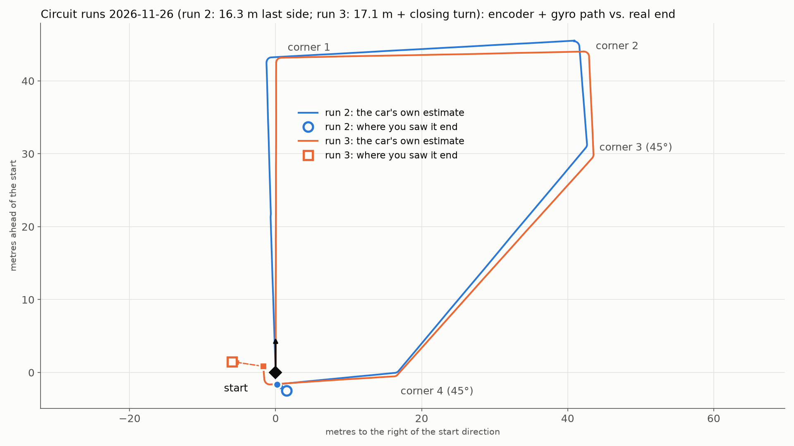

# The circuit: closed-loop route runs (`car_route.c`)

Written 2026-11-26 after the first full-circuit runs (2026-11-25 and
2026-11-26, Filip walking next to the car, Claude logging over Bluetooth).
The route sequencer `car_route.c` was written by Hakon on 2026-11-25
(on `main`); the route used on the track was programmed by a teammate.

## What the route does

A route is up to 32 steps, each one of:

- `s <m>`: a straight distance run (position PID + speed loop + gyro
  heading hold), at `vn` (70 cm/s on `main`).
- `t <deg>`: a turn by gyro. The servo goes to `sc ± rtu` and the speed
  loop holds `rtv` (22 cm/s) until the gyro heading is within `rtl`
  degrees of the target; then the next step starts. Targets add up
  (`rtTargetYaw += angle`), so an early stop in one turn does not carry
  into the next one. `+` = left, `−` = right.
- `w <s>`: stand still. The gyro zero (bias) is only trimmed while the car
  stands still, so a wait before each turn stops the heading error from
  growing over a long run.

Commands: `rp s42.5 w10 t-88.8 ...` sets the whole route (the car's command
line is only 64 characters long: put the rest in with `rs <n> <type>
<val>`, end with `rs <n> 0`), `rp` prints it, `rg` starts it 2 s later,
`rb 1` lets the blue button start it, `rtu`/`rtv`/`rtl` change the turns.
Anything typed is lost at a reset (and unplugging the USB is a reset).

## Going around an obstacle

Added 2026-11-26. First runs on the car 2026-11-27 (6 m straight, a box
at about 3 m, `vn 30`, commands over Bluetooth):

| Run | Settings | What happened |
|---|---|---|
| 1 | `raw 5`, `rab 0.5` | Started the detour, but after backing up 0.5 m and the 45 degree turn (which moves the car about 52 cm forward) it pointed at the box again: "the detour is blocked", stood about 30 s. |
| 2 | `vn 70`, `rab 1.2` | Saw the obstacle at 86 cm, rolled to 19 cm while braking, then the wait kept starting over and the car crept on: each lost echo cleared `obstacle`. Touched the person standing in front. |
| 3 | `vn 30`, `so 2`, `rab 1.2` | **All the way around**: back 1.19 m, out, beside it, in, back on the line (10 cm to the side), ROUTE DONE. Stopped about 1 m before the box (`so 1` is closer). |
| 4 | `so 1`, `rab 1.2` | All the way around, stopped 58 cm before the box, 15 cm to the side at the end. Smooth. The professor: it backs up a little too far. |
| 5 | `rab 0.8` | Stopped by the laptop watcher (the wait had restarted 3 times), not by the car. |
| 6 | `raw 10`, `rab 0.8` | All the way around, but paused after the first turn and beside the box, looked rough. Ended about 10 degrees to the right by eye, with only 0.76 m left to straighten out. |
| 7 | `rab 1.0`, `rtl 2` | Started without a clear go from the team, the car was lifted off a table. |
| 8 | 70 degree arcs, `rao 0` | Old firmware crept from 60 to 21 cm while waiting, stopped by the watcher. |
| 9 | new firmware, arcs | First detour: back 0.81 m, S out, 1 m beside it, S back, **1 cm from the line**. Then a second obstacle and a second detour; picked up by hand. |
| 10 | same | Two detours, 3 and 9 cm from the line, ROUTE DONE, but it paused in the middle of an arc for something at 51 cm. |
| 11, 12 | same | Around without a stop (run 12), back on the line 1 and 7 cm to the side. With several interruptions it ended a little beside the line: fixed by steering back to the line (below). |

Fixed after these runs:

- `obstacle` clears only after 1 s of clear readings in a row
  (`OBST_CLEAR_STEPS`): one lost echo let the old code creep on.
- The detour is two smooth S arcs: back up 0.8 m, turn 70 degrees out and
  70 degrees back (`raa 70`, no diagonal, `rao 0`), 1 m beside it, the same
  S back. 96 cm to the side, about 1.4 m along for each S. The S out and
  the S back are mirror images, so a car that turns wider one way still
  ends on the line.
- After a detour the rest of the straight aims back at the line,
  `ROUTE_LINE_GAIN` (0.5) degrees per cm off it, at most 15. The offset is
  added up over all detours of the straight.
- `ram` (room beside the line, default 1.5 m): the detour is fitted into
  it, so it does not run into a curb; if it cannot fit, the car waits.
- Defaults `raw 10`, `rab 0.8`.
- `tools/route_sim`: wider sonar (`cone=15`), lost echoes (`miss=`), a bump
  (`nudge=`, `nudget=`), different turn radius left and right (`radl=`,
  `radr=`), and how far the car went to the side. It reproduces run 2 with
  the old code (the car creeps into the box).

Things learned: the stop is always reported at about 58 cm because that
is the stop distance at 30 cm/s (30 cm + 1 s x 30 cm/s), not one object.
On open floor the sonar read a steady 182 cm at every steering position,
so the pauses were real things in front (people walking next to the car).
Walk behind the car. A turn pauses for an obstacle like a straight does.
`vn 30` and `rtl 2` were typed in for these runs, not in the code.

1. The sonar stops the car early enough: 30 cm + 1 s of driving, so
   100 cm at 70 cm/s (`so`, see [control.md](control.md#obstacle-pause)).
2. The straight waits. If the obstacle goes away, it simply goes on.
3. Still blocked after 10 s (`raw`): back up 0.8 m (`rab`), turn 70 degrees
   out (`raa`, left by default, `ras -1` = right), turn back parallel
   (with `rao` > 0 a diagonal comes between the turns), 1 m beside the
   obstacle (`rap`), turn in, turn back onto the line, then the rest of the
   straight, aimed back at the line. The legs run at 30 cm/s (`rav`); the
   turns use `rtu`/`rtv`/`rtl` like route turns. With the defaults the car
   is 96 cm to the side and the detour covers about 3.1 m along the straight.
4. How far along the straight it got is added up from the encoder and the
   gyro while it drives, so the rest of the straight comes out right even
   if a turn is a bit wider. The car prints it: `around it, 3.82 m along,
   2 cm to the side, 2.15 m left`.

What it cannot do: the sonar only looks forward, so the car does not know
how wide or how long the obstacle is. Set `rao`/`rap` for what the course
uses. If the detour itself is blocked (obstacle wider than about 2 m, or
something else in the way), the car stops, says `the detour is blocked`
and waits; no second detour. If the obstacle is close to the end of a
straight, the detour carries the car past the corner (it says by how
much) and the route goes on from there.

Tried in `tools/route_sim` (real `car_route.c` and `car_drive.c`, model
car, a 50 x 50 cm box at 5 m of a 10 m straight): back on the line within
2 cm and at 9.99 m, closest 54 cm to the box; both sides; a following turn;
a box taken away during the wait (no detour); boxes 1.5 m wide or deep
(closest 19 cm); a box 2.4 m wide (detour blocked, waits); the gyro 1.35 %
low.

## Settings that worked best (2026-11-26, typed over Bluetooth, not in the code yet)

| Setting | Code default | Used | Why |
|---|---|---|---|
| `sc` | 1080 | **1108** | The heading hold is P only. Driving straight needed about 1108 µs, so with `sc 1080` the hold sat 1.5-2 degrees left of its target on every straight (`15 µs/deg x 2 deg = 30 µs`). On side 2 that took the car about 2 m towards the left curb. With 1108 the error on the straights is about 0. A heading I term would do this by itself. |
| `rtu` | 250 | **222** | Keeps the turn pulse at 1330 µs (`sc + rtu`) after the `sc` change. Turn radius at 1330 µs: 73 cm (circle test). |
| `rtl` | 4 | **2** | With 4 the turns ended 2.0-2.6 degrees short (the car rolls on about 1.5 degrees after the servo straightens); the hold then fixed the rest on the next straight. |
| turns | −90 / −45 | **−88.8 / −44.4** | The gyro reads about 1.35 % too few degrees (circle test below). |

The route of run 7 (16:24, all the way round; typed in, a reset loses it):

```
rp t2.7 s42.5 w10 t-88.8 s41.5 w10 t-88.8 s13.5 w10 t-44.4
rs 11 s 40
rs 12 w 10
rs 13 t -44.4
rs 14 s 11.1
rs 15 w 10
rs 16 t -88.8
rs 17 s 0.5
rs 18 0
rs 4 t -84.8
```

`t 2.7` at the start turns the whole loop 2.7 degrees left (side 1 had
drifted 2 m right: the start placement). Corner 1 at −84.8 because Filip
saw it turn too far (3 m to the right over side 2). The last side (11.1 m)
and the closing turn come from where run 3 ended. These are tuned to how
the car was put on the start mark that afternoon: tape a line along the
first straight, or the first metres decide the rest.

## The track route

As programmed by the team (lengths measured by them, angles estimated):

```
s 42.5, t -90, s 41.5, t -90, s 13.5, t -45, s 40, t -45, s 16.3
```

That is only 270 degrees of turning: the car ends pointing 90 degrees left
of the start. Run 3 added a wait before every turn, a last 90-degree turn
and a short straight back to the start line.



Runs 2 and 3. Both paths are the car's own estimate: encoder distance
along the gyro heading, rebuilt from the telemetry.

## The runs

Telemetry: `tools/circuit_runs/<date>/route_*.csv` (copied from
`tools/logs/`, which git ignores), 5 lines a second, none missing when
someone walks next to the car with the laptop (Bluetooth reaches about
10 m). Columns as `T` telemetry, with the laptop's clock in front; the
car's messages are the `#` lines at the end. Heads-up: `yaw_deg` is the
heading error during a straight (state 1-4) and the plain heading
otherwise.

| Run | Route | What happened |
|---|---|---|
| 11-25 15:06 triangle | 3 x (s 1.5, t −120), vn 70 | Turns ended 1.4-2.9 degrees short. The 1.5 m straights overshot by up to 79 cm and the position loop backed up; while backing up the heading hold steered the wrong way (heading error to −6 degrees), see below. |
| 11-25 15:10 circuit 1 | team route, no waits, turns −90 | Side 1 (42.5 m): 0.5 cm short, heading within 0-2.6 degrees. After corner 1 the car crossed side 2 on a diagonal to the right and hit the curb at 34.7 m (2-3 m margin each side at the start). Gyro said +1.5 degrees left the whole time. The motor then pushed at 100 % for 3.5 s and the stall check did not stop it. |
| 11-25 15:24 circles | 15 x t −120 (5 rounds right) | Gyro 1797 degrees. The car went 27 cm past its start point; with the measured radius (72.9 cm from 23.16 m of encoder) that is 21 degrees, so the real turn was 1821 degrees: factor 1.0135. Single measurement, end position judged by eye. Z axis saw 87 degrees: the module is tilted only about 3 degrees. |
| 11-26 14:01 circuit 2 | + 10 s waits before turns, turns −88.8/−44.4 | **All the way round.** A person in front at 9.2 m (sonar stop 16 s, then it went on by itself); at 21.4 m it hit another team's car and was moved a little by hand. Straights within 2.5 cm of their length, turns ended 2.0-2.6 degrees short, heading error on the straights a steady +2 degrees (left). Side 2 drifted from the middle to about 1 m from the left curb. Ended (Filip, steps) about 2.5 m behind the start line and to the right, pointing 90 degrees left. |
| 11-26 14:19 circuit 3 | + `sc 1108`, `rtu 222`, `rtl 2`, last side 17.1 m, + w 10, t −88.8, s 1.8 | No collision. Straights within 2.3 cm, heading error about 0 on the straights. Filip: drifted slightly left from the start (car placed not quite straight), corners looked like 90 degrees, after corner 3 it headed for a table on the right side; after corner 4 it was already near the finish and then drove much too far. Ended 1.5 m ahead of and 6 m to the left of the start line. |
| 11-26 15:57 / 15:58 run 4 | last side 11.1 m, closing straight 0.5 m (a teammate had flashed a new build in between; settings typed again) | Stopped by hand twice. A third of the sonar readings were 0-2 cm (none in the morning): false obstacle stops, after which the car rolled on with the motor off and overshot side 2 by 1 m. Cause: a loose sonar wire, fixed. |
| 11-26 16:09 run 5 | same | Side 1 within ±1.6 degrees up to 36 m, then something in front and the car was turned by hand; during the 10 s stop it was turned again, so the gyro counted that as the turn and the car set off on side 2 in the wrong direction (stopped). Do not touch the car during a route: `s` first. |
| 11-26 16:12 run 6 | + `t 2.7` before side 1 (Filip saw 2 m drift to the right on side 1) | Sides 1 and 2 within 0.3 cm. Filip: corner 1 turned too far, side 2 drifted 3 m right. Stopped at the start of side 3: that spot slopes up, the car came out of the turn rolling, the motor cut out, it rolled back more than 3 cm and the encoder-direction check ended the route; then it rolled 2 m back down with the motor off. Same spot as the backwards roll of 11-25. |
| 11-26 16:24 run 7 | + corner 1 −84.8 | **All 17 steps, ROUTE DONE.** Straights within 3.2 cm. On the diagonal it stood about 26 s for real obstacles (people). Filip: "decent enough". |
| 11-26 16:31-16:36 | same | Three more starts, stopped by Filip each time (track busy). |

## What is understood and what is not

Understood:

- The car does what the route says, by its own sensors: every straight
  within 2.5 cm, every turn within about 2 degrees of the gyro target, the
  gyro still to 0.1 degree during every 10 s stop.
- The P-only heading hold leaves a steady offset (fixed with `sc`).
- The gyro reads about 1.35 % low (one circle test).
- A constant heading error rotates the whole path around the start. It
  pushes the car towards a curb on the long sides but hardly moves the end.

Not understood (open on 2026-11-26):

- The two real end points differ by about 6 m more than the changes made to
  the route between the runs. No single gyro factor (0.99-1.03) and no
  constant gyro drift (±1.8 degrees/min) explains both runs (checked with
  the telemetry; run 2 wants factor 0.99 or +1.4 deg/min, run 3 wants
  factor 1.02 or −0.4 deg/min, and still misses by 2.4 m). The car
  estimated the start of the last side at 16 m from the start line;
  Filip saw it close to the finish there in run 3.
- Likely: the real corner angles are not 90/90/45/45 (the 45-degree corner
  sent the car towards the right side in run 3), the start was not placed
  the same way each time, and the end points were judged by steps.

## How to measure the next run

1. Mark the start: a tape line along the first straight (2-3 m), the car's
   side against it, and a mark for the rear wheels. 1 degree of placement
   is 0.75 m at the end of the first side.
2. At every 10 s stop: note where the car stands (metres from the right
   curb, and from the corner if possible) and whether it points along the
   road. The stops are at the corners, so this gives the real corner
   positions to compare with the car's estimate.
3. At the end: tape (not steps) from the start mark: metres ahead and
   metres left/right, and the angle of the car to the start line.
4. Better still: a map. A screenshot of the track from an online map with
   a scale bar gives the real lengths and corner angles.

## Firmware problems seen (not fixed yet)

- **Heading hold when backing up.** `car_heading.c` flips the steering sign
  only for a run planned in reverse. When a forward run overshoots and the
  position loop backs up, the hold steers the wrong way and the heading
  error grows. Fix: take the sign from the measured speed.
- **Stall check.** 3.5 s at 100 % against a curb did not stop the motor; a
  few stray counts reset the timer.
- **"Encoder counts the wrong way"** stopped a route when the car was only
  rolling back (picked up by hand). It should not end a route.
- `sc`, `rtu`, `rtl` and the route are only typed in; they belong in the
  code once a route works.
